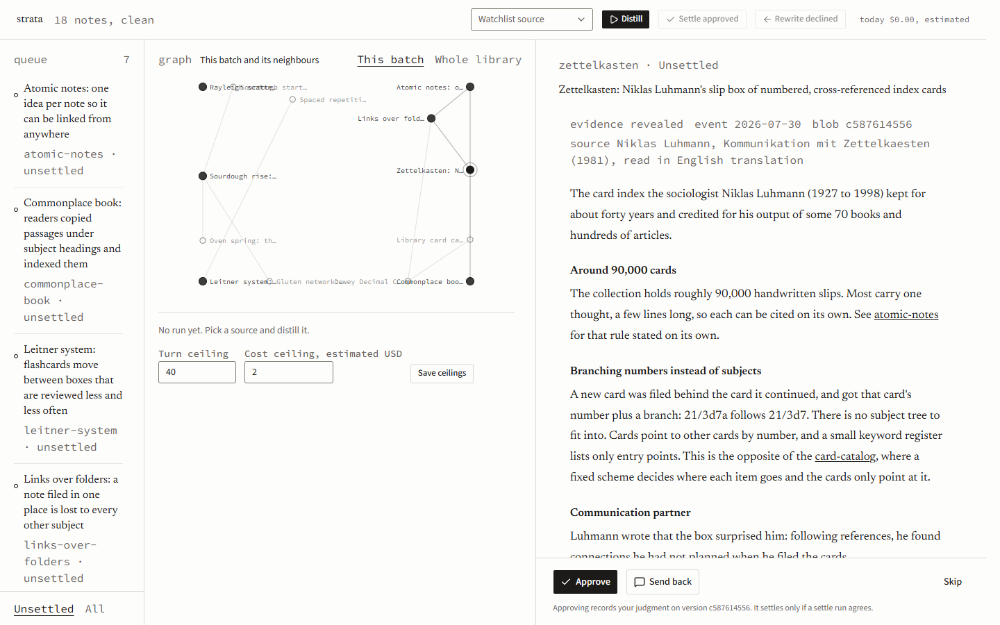

Strata is my personal knowledge base. AI agents write notes only through three fixed workflows; every agent-written note lands as unsettled, and only my approval in a review app promotes it.



## How it works

1. Agents write notes through two Claude Code skills: `/kb-note` records an idea I just said, and `/kb-distill` turns one source document into at most one note.
2. Every new note lands in `notes/` with `status: unsettled`, meaning nobody has approved it yet.
3. I read the note in the review app and press Approve or Send back. The approval is recorded against the note's exact version (its git blob hash), so if the note is edited later, it needs a new approval.
4. `/kb-settle` re-checks the approved notes (one unit per note, links correct) and changes a note to `settled` only when its check agrees with my approval of that same version.

The rules every note follows are in [spec/](spec/), and `python -m kb doctor` checks every note against them. Unattended runs started from the review app use the Claude Agent SDK with permission prompts bypassed and a hook that blocks `git push`. The three-workflow rule comes from the skill instructions and the doctor check, not from a sandbox.

## Run it

Requirements: Node 22.12 or later, Python 3.12.

```bash
npm ci
npm start
```

Open the URL it prints (`http://127.0.0.1:5177` by default; set `BENCH_SERVICE_PORT` to change it). The repo ships with 18 sample notes in `notes/`, so the review queue has content on first start. Reviewing needs nothing else; starting a distill, settle or rewrite run from the app also needs a working Claude Code login.

```bash
npm test          # service tests (node), web tests (vitest), kb tests (python)
npm run typecheck
```

## Layout

- `kb/`: the `kb` command line in Python (`python -m kb doctor | list | query | related | graph | hubs | frontier | ingest | watch | root`).
- `apps/service/`: local Node service; reads notes through `kb`, stores reviews keyed by blob hash, and starts agent runs.
- `apps/web/`: the review app (React and Vite): unsettled queue, link graph, note with Approve and Send back.
- `spec/`: the note rules: [note-spec.md](spec/note-spec.md), [fields.md](spec/fields.md) and the failure log.
- `.claude/skills/`: the three workflows, `kb-note`, `kb-distill` and `kb-settle`.
- `notes/`: the knowledge base itself, here filled with sample notes; `strata.config.json` points `kb` at it.
- `tests/`: Python tests for `kb` plus fixtures; the service and web tests sit next to their sources.

## Status

Personal tool, v0. The three skill prompts are written in Chinese; the service, web app and specs are English. The `kb` CLI's messages and most code comments in `kb/` and `tests/` are also still in Chinese.

## License

MIT, see [LICENSE](LICENSE).
